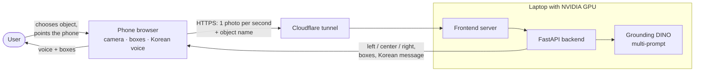

# CakGo (찾고): find everyday objects with your phone camera

CakGo is a phone web app that helps people find a **wallet, keys, glasses or a remote control**. You choose the
object and point the phone around the room. CakGo draws a box around the object and says in **Korean** whether it is
on the **left, in the center or on the right** of the screen.

It was built in one week (15–22 October 2026) by a team of four as an IC-PBL project. The main work was finding a
detection model that works on **real phone camera frames**, not only on benchmark images.

> **한국어 요약:** 찾고는 휴대폰 카메라로 지갑, 열쇠, 안경, 리모컨을 찾아 주는 웹 서비스입니다. 찾을 물건을 고르고
> 휴대폰을 비추면, 물건이 화면의 왼쪽·가운데·오른쪽 중 어디에 있는지 한국어 음성으로 알려 줍니다. 시각적 어려움이
> 있는 분들과 작은 물건을 자주 잃어버리는 분들을 위한 서비스입니다. 여러 탐지 모델을 비교한 결과, 공개 데이터셋에서는
> 파인튜닝한 YOLO가 가장 좋았지만 실제 휴대폰 사진에서는 **Grounding DINO 멀티 프롬프트**가 가장 좋아 최종 모델로
> 선택했습니다.

## Why

People with visual difficulties, and anyone who often misplaces small things, can spend a long time searching for
keys or glasses. A phone is always at hand, but most object finders need special hardware or tags. CakGo only needs
a phone browser: no app to install, no tags on the objects.

## How it works



1. The phone browser opens the rear camera and sends one photo about every second, together with the chosen object.
   Phone cameras only work on HTTPS pages, so the laptop is reached through an HTTPS tunnel.
2. The backend asks the detector for that object. The center of the most confident box decides the direction:
   left, center or right third of the frame.
3. The phone draws the boxes and speaks, e.g. *"찾는 물건이 화면 오른쪽에 보입니다"* (the object is on the right of
   the screen). To keep the voice calm, it only speaks when **two frames in a row** agree, and repeats "not visible"
   at most every 10 seconds.
4. Photos are processed in memory and not stored or logged.

The detector runs on a laptop GPU: about **0.3 s per photo** (RTX 4050). In a phone test, a box appeared a median of
**2.7 s** after the object came into view (30 trials); the voice follows slightly later.

## Results

### The main finding: benchmark scores did not predict real use

| Step | What happened |
|---|---|
| 1. Benchmark (70 dataset images) | Fine-tuned **YOLO looked best**: mean AP50 0.94, no false alarms, 15 ms per image. |
| 2. First phone test (real desks) | Fine-tuned YOLO found **1 of 4** objects. Grounding DINO found 4 of 4 but called a **mouse, keyboard and router "remote control"**. |
| 3. Fix | **Multi-prompt**: ask for all four objects *plus look-alikes* (mouse, keyboard, pen…) at once, so each box gets its best-matching word. False alarms on validation images: **53–94 % → 5–16 %**, no training needed. |
| 4. Real-photo test (94 team photos) | Grounding DINO multi-prompt had the **best balance** of found objects and false alarms (table below). |
| 5. Newer models (YOLOE-26, SAM 3, few-shot) | None beat Grounding DINO multi-prompt on both accuracy and speed. |

**Real-photo test:** 94 photos the team took at home, 80 with one of the objects and 14 without. All models used the
same photos, and nothing was tuned on them. Results: [`tests/results/real_photos/COMPARISON.md`](tests/results/real_photos/COMPARISON.md).

| Object | Fine-tuned YOLO<br/>found / false alarm | **Grounding DINO multi-prompt**<br/>found / false alarm | Grounding DINO single prompt<br/>found / false alarm |
|---|---|---|---|
| Wallet | 17 % / 1 % | **50 % / 11 %** | 96 % / 50 % |
| Keys | 30 % / 1 % | **50 % / 15 %** | 100 % / 85 % |
| Glasses | 46 % / 10 % | **50 % / 3 %** | 96 % / 53 % |
| Remote control | 58 % / 1 % | **92 % / 21 %** | 100 % / 93 % |
| **Balance** (found − false alarm), mean | 0.34 | **0.48** | 0.28 |

- *Found* = share of photos of the object where the model said yes.
- *False alarm* = share of photos **without** the object where it still said yes.
- These are preliminary detection results: Grounding DINO's box positions on these photos have not yet been checked
  by hand. YOLO's were checked, and 26 of 28 boxes were on the right object.

**Final model: Grounding DINO tiny with the multi-prompt** (threshold 0.35). It finds all four objects without
training and has few false alarms. It works well on cluttered desks (15/16) and partly hidden objects (7/8), and is
weaker far away (2/8) and in dim light (4/8).

### Everything we tried

| Approach | Result | Details |
|---|---|---|
| Pretrained YOLO26s (COCO) | Only knows remote controls | [`tests/results/model_comparison_report.md`](tests/results/model_comparison_report.md) |
| YOLO26s fine-tuned on 6,514 images (v1, v2) | Best on the benchmark, but overfits wallets and misses most real objects | [`detection/experiments/yolo/`](detection/experiments/yolo/README.md) |
| Grounding DINO, single prompt | Finds everything, but false alarms on 50–93 % of photos without the object | [`detection/experiments/grounding_dino/`](detection/experiments/grounding_dino/README.md) |
| **Grounding DINO, multi-prompt** | **Best balance → chosen** | [`MULTI_PROMPT.md`](detection/experiments/grounding_dino/MULTI_PROMPT.md) |
| YOLOE-26, SAM 3 (newer open-vocabulary models) | YOLOE fast but misses about half; SAM 3 accurate but 6× slower | [`tests/results/zero_shot_70/`](tests/results/zero_shot_70/COMPARISON.md) |
| Few-shot "register my item" (example photos) | Did not beat typing the object name | [`tests/results/few_shot/`](tests/results/few_shot/README.md) |
| DINOv3 check of Grounding DINO's boxes | Cut false alarms further (24 → 8 of 220); a candidate for later | [`tests/results/few_shot/`](tests/results/few_shot/README.md) |

### Data and metrics

- **Dataset:** *Objects In House* v5 from Roboflow Universe (CC0, 9,868 images). The shared test set has 70 images:
  15 per object and 10 without any. Duplicates were removed, and test images and their near-duplicates were kept out
  of training. Every image file has a checksum, so all teammates provably used the same files.
  See [`tests/dataset/`](tests/dataset/README.md).
- **Real photos:** taken by the team, kept private (never committed). Only aggregate results are published.
- **Why these metrics:** for someone who cannot see the screen, a wrong direction is worse than "not visible". So we
  measure **both** how often the object is found and how often the app wrongly claims to find it (false alarms),
  and also **speed**, because the app must feel live. On the benchmark we also report AP50, precision and recall,
  and whether the most confident box (the one the voice talks about) is correct.

### Limitations

- About half of wallets, keys and glasses are missed **in a single photo**, especially far away or in dim light.
  The app keeps sending frames while the user moves, which should help, but that is not measured yet.
- Button-like objects can still be mistaken for a remote control (21 % false alarms).
- Small test set (94 photos from 3 people), and no study with users with visual difficulties yet.
- The detector needs a laptop or server with an NVIDIA GPU; the phone only captures and speaks.

**Future work:** multi-frame evaluation, the DINOv3 check in the app, testing with target users, vibration (works on
Android; iPhone browsers don't support it) or directional sounds, and more real training photos.

## Run the demo

On a Windows laptop with an NVIDIA GPU, after the one-time setup, double-click **`scripts\start_demo.cmd`**. It
starts everything and prints an HTTPS link. Open the link on the phone, choose an object and press
**Start Camera**.

Full instructions, including setup, the demo sequence and troubleshooting: **[`docs/DEMO_GUIDE.md`](docs/DEMO_GUIDE.md)**.

## Repository structure

```text
├── frontend/                 Phone web page: camera, object choice, boxes (index.html), dev server
├── backend/                  FastAPI API: POST /api/detect → direction + boxes + Korean message
├── voice/                    Korean voice guidance in the browser (two-frame confirmation)
├── detection/experiments/
│   ├── grounding_dino/       Final detector (multi-prompt), benchmarks
│   └── yolo/                 YOLO fine-tuning and evaluation
├── tests/
│   ├── dataset/              Shared 70-image test set (download/verify scripts; images not committed)
│   ├── real_photos/          Real phone photo scoring (photos kept private)
│   ├── zero_shot/            YOLOE / SAM 3 / few-shot experiments
│   └── results/              All comparison results
├── scripts/                  One-command demo start
└── docs/                     Demo guide, API contract, result analysis, presentation notes, meeting reports
```

## Team

| Member | Main work (from the GitHub history) |
|---|---|
| 나즈미 (Jeminana) | Shared dataset and preprocessing, YOLO fine-tuning, real-photo test, demo start script, documentation |
| 김철연 (kcyoow) | Grounding DINO experiments and multi-prompt, camera–backend connection, YOLOE / SAM 3 / few-shot experiments |
| 오가암 (keyanwu256-eng) | Phone camera page, Grounding DINO hook-up in the backend, larger text, phone timing test |
| 상싱위 (Thehxliday68) | Backend API, Korean voice guidance and its phone integration, documentation and slides |

## Documentation

- [`docs/DEMO_GUIDE.md`](docs/DEMO_GUIDE.md): how to run the live demo
- [`docs/2026-10-20/RESULT_ANALYSIS.md`](docs/2026-10-20/RESULT_ANALYSIS.md): full result analysis and how the model was chosen
- [`docs/API_CONTRACT.md`](docs/API_CONTRACT.md): API between phone, backend and detector
- [`docs/README.md`](docs/README.md): all documents, including meeting reports and presentation notes

## For contributors

- Never commit dataset images, model weights, API keys or the team's private phone photos (`tests/real_photos/` is
  gitignored). Download data only with the documented scripts, and keep the Roboflow API key in an environment
  variable.
- Changing the model, prompts or thresholds requires re-running the real-photo test (`tests/real_photos/`) and
  updating `tests/results/real_photos/COMPARISON.md`.
- Keep component interfaces as in [`docs/API_CONTRACT.md`](docs/API_CONTRACT.md); work on `feature/*` branches and
  merge through reviewed pull requests.
- AI coding agents: read this README, the component's own README and the API contract first; keep edits scoped to
  one component.
